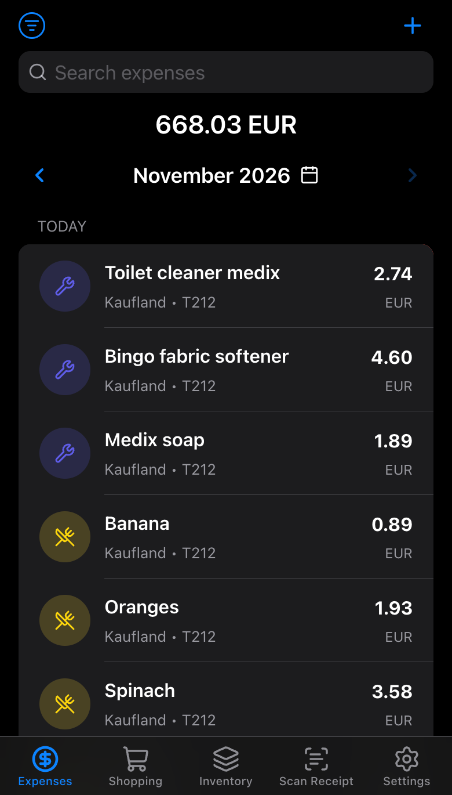
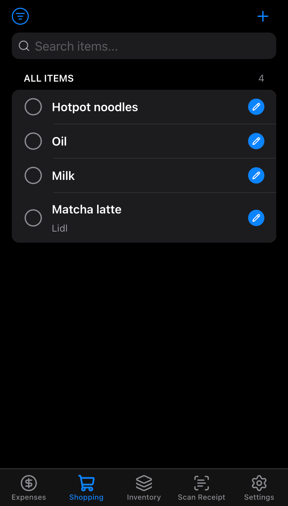
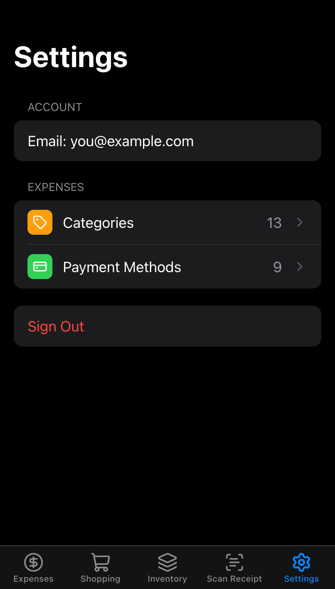

# Lifestyle OS — Web

Next.js + Tailwind port of the iOS app in `../Lifestyle OS`, using the **same Supabase database**.
Built mobile-first (iOS look: inset grouped lists, sheets, bottom tab bar); on tablets/desktop the
tab bar becomes a sidebar and sheets become centered dialogs.

## Screenshots

<p>
  
  
  
  
  
</p>

## Run

```bash
cp .env.example .env.local   # then fill in values (see below)
npm install
npm run dev                  # http://localhost:3000
```

| Variable | Purpose |
|---|---|
| `NEXT_PUBLIC_SUPABASE_URL` / `NEXT_PUBLIC_SUPABASE_ANON_KEY` | Same project + publishable key as `Config/SupabaseConfig.swift` |
| `GEMINI_API_KEY` | Server-only, for receipt scanning ([get one](https://aistudio.google.com/apikey)) |
| `GEMINI_MODEL` | Defaults to `gemini-3.5-flash-lite`, the iOS model |

## Screens (iOS → web)

| iOS | Web |
|---|---|
| `LoginView` / `SignUpView` | `components/LoginView.tsx` |
| `ExpenseListView`, `AddExpenseView`, `EditExpenseView`, `ExpenseDetailView`, `MonthPickerView` | `app/expenses`, `components/expenses/*` |
| `ShoppingListsView`, `AddShoppingListView`, `EditShoppingListView` | `app/shopping`, `components/shopping/*` |
| `InventoryListView`, `AddInventoryItemView`, `InventoryDetailView` | `app/inventory`, `app/inventory/[id]` |
| `ReceiptScannerView` | `app/scan` + `app/api/scan-receipt` |
| `SettingsView` | `app/settings` |

## Notes

- Data access is client-side with supabase-js (like the Swift services), so Row Level Security does the work. As on iOS, `account_id` and `created_by_user_id` are the signed-in user's id.
- Dates are saved at local noon (`noonISO`), the same as `Calendar.noon(for:)` on iOS.
- Receipt scanning sends the photo (downscaled to 1600px) to `/api/scan-receipt`. The route checks the Supabase session, then calls Gemini with the iOS prompt. Gemini reads the image directly, so there is no separate OCR step.
- Swipe left on a row to delete it. With a mouse, hover over the row for a delete button.
