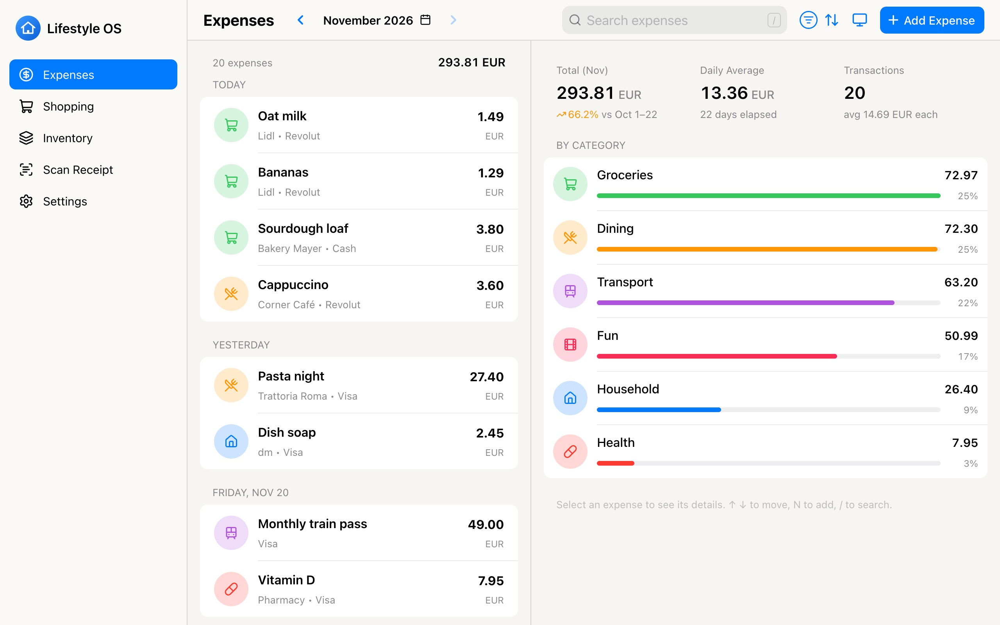
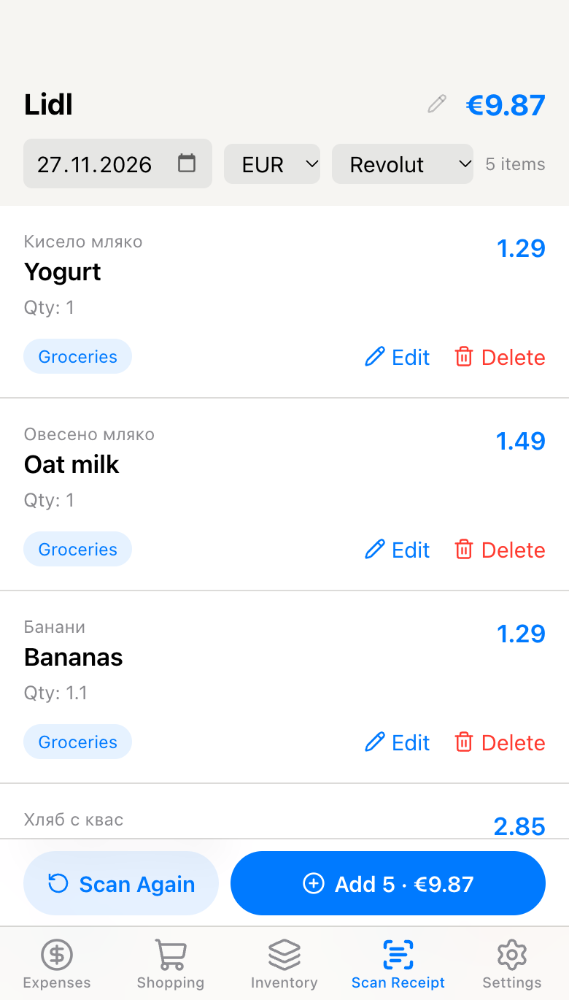

# Lifestyle OS — Web App



A personal household app for tracking monthly expenses by category and payment method, keeping a shopping list, and managing a home inventory with expiry dates. Photograph a supermarket receipt and AI translates to English and automatically add the items to your expense list in one go.

Next.js + Tailwind port of the iOS app in `../Lifestyle OS`, using the **same Supabase database**.
Built mobile-first (iOS look); on tablets/desktop the tab bar becomes a sidebar and sheets become centered dialogs.
On wide screens, Expenses becomes an iPadOS-style split view (see [Desktop](#desktop)).

## Screenshots

<p>
  
  
  
  
</p>

## Run

```bash
cp .env.example .env.local   # then fill in values (see below)
npm install
npm run dev                  # http://localhost:3000
```

| Variable | Purpose |
|---|---|
| `NEXT_PUBLIC_SUPABASE_URL` / `NEXT_PUBLIC_SUPABASE_ANON_KEY` | Same project + publishable key as `Config/SupabaseConfig.swift` |
| `GEMINI_API_KEY` | Server-only, for receipt scanning ([get one](https://aistudio.google.com/apikey)) |
| `GEMINI_MODEL` | Defaults to `gemini-3.5-flash-lite`, the iOS model |

## Desktop

From 1024px wide (laptop, or iPad in landscape), **Expenses** shows the list on the left and an overview or inspector pane on the right, with a single toolbar on top:

- **Nothing selected:** total with change vs last month, daily average, transaction count and a category breakdown. For the current month the comparison uses the same days of last month (e.g. Nov 1–22 vs Oct 1–22). Click a category to filter the list.
- **Expense selected:** its details, with Edit and Delete.
- **Right-click a row** (mouse or trackpad): Edit, show only that category, copy amount, delete.

Narrower windows keep the phone layout, and tapping a row opens the detail sheet.

### Keyboard shortcuts (Expenses)

| Key | Action |
|---|---|
| `/` or `⌘K` / `Ctrl+K` | Focus search |
| `↓` (in search) | Jump to the first result |
| `Esc` (in search) | Leave the search field |
| `N` | Add expense |
| `↑` `↓` or `K` `J` | Select previous / next expense |
| `Enter` or `E` | Edit the selected expense |
| `Backspace` / `Delete` | Delete the selected expense (asks first) |
| `Esc` | Clear the selection |

Selection shortcuts need the split view (1024px or wider). `/`, `⌘K` and `N` work at any width. Shortcuts are ignored while typing in a field or while a dialog is open. Adding uses `N` rather than `⌘N` because browsers reserve `⌘N` for a new window.

## Sign-in

Email sign-in through Supabase Auth, sent via Resend on our own domain (custom SMTP in Supabase).

| Method | How it works | Code |
|---|---|---|
| **Magic link** (default) | Enter an email and get a link. An unknown email gets an account on its first link, with no password. | `sendMagicLink` in `components/AuthProvider.tsx` |
| **Password** (backup) | "Sign in with password instead" shows email + password and a **Sign Up** form. | `signInWithPassword`, `signUp` |
| **Set Password** | Settings → Account. Magic-link users can add a password; anyone can change theirs. | `components/SetPasswordSheet.tsx` |

**When emails can't be sent.** If Supabase returns the email rate-limit error, the login screen switches to the password form and says why. Password sign-up only avoids email when **Confirm email** is off in Supabase (Authentication → Sign In / Providers → Email). With it on, sign-up also sends an email and fails the same way.

**Email links go through `/auth/confirm`.** Templates link to `{{ .RedirectTo }}?token_hash={{ .TokenHash }}&type=email` instead of `{{ .ConfirmationURL }}`. The page calls `verifyOtp` only when the user presses **Continue**. Email security scanners (Outlook Safe Links, Microsoft Defender) open links before the user does, and a direct verify link would be spent by that visit. `AppShell` renders this page without the login gate. See `supabase/templates/README.md`.

**After the first sign-in.** The `SIGNED_IN` listener runs `ensureDefaultAccount`, which creates the user's "Personal" account (id = user id) if it is missing. Its `signed_up_at` column (default `now()`) records when the user joined.

```sql
select date_trunc('month', signed_up_at) as month, count(*) from public.accounts group by 1 order by 1;
```

**Supabase settings this relies on:**
- Authentication → Sign In / Providers: **Allow new users to sign up** on (needed for sign-up by magic link).
- Authentication → URL Configuration → Redirect URLs: `https://www.lifestyleos.homes/**` and `http://localhost:3000/**`. Otherwise Supabase swaps in the Site URL and links miss `/auth/confirm`.
- Authentication → Emails → Templates: **Magic Link** and **Confirm signup** pasted from `supabase/templates/`.
- **Secure password change** off. Otherwise Set Password needs an emailed confirmation too.

### Email delivery (Resend)

Supabase's built-in mailer is for testing only and allows very few emails per hour, so auth emails go through Resend.

**1. Set up Resend** ([resend.com](https://resend.com))
1. Create an account.
2. **Domains → Add Domain** and enter the domain (e.g. `lifestyleos.homes`).
3. Add the DNS records Resend shows to the DNS provider (Cloudflare, Namecheap, etc.).
4. Wait for the domain to verify. Resend won't send from your own address until it does.
5. **API Keys → Create API Key** with sending permission, and copy the key (`re_...`).

**2. Point Supabase at Resend.** Authentication → Emails → **SMTP Settings** (older dashboards: Auth settings → SMTP). Turn on **Enable Custom SMTP** and fill in:

| Field | Value |
|---|---|
| Host | `smtp.resend.com` |
| Port | `465` |
| Username | `resend` |
| Password | the Resend API key (`re_...`) |
| Sender email | `no-reply@<your domain>` |
| Sender name | `Lifestyle OS` |

**3. Raise the email rate limit.** Authentication → **Rate Limits** → **Rate limit for sending emails**: set to **50** emails per hour and save. This field only becomes editable once custom SMTP is on. It caps every auth email (magic links, sign-up confirmations, password resets) across the whole project, not per user. When it is hit, the login screen falls back to the password form (see above).

## Screens (iOS → web)

| iOS | Web |
|---|---|
| `LoginView` / `SignUpView` (merged, see [Sign-in](#sign-in)) | `components/LoginView.tsx` |
| `ExpenseListView`, `AddExpenseView`, `EditExpenseView`, `ExpenseDetailView`, `MonthPickerView` | `app/expenses`, `components/expenses/*` |
| `ShoppingListsView`, `AddShoppingListView`, `EditShoppingListView` | `app/shopping`, `components/shopping/*` |
| `InventoryListView`, `AddInventoryItemView`, `InventoryDetailView` | `app/inventory`, `app/inventory/[id]` |
| `ReceiptScannerView` | `app/scan` + `app/api/scan-receipt` |
| `SettingsView` | `app/settings` |

## Notes

- Data access is client-side with supabase-js (like the Swift services), so Row Level Security does the work. As on iOS, `account_id` and `created_by_user_id` are the signed-in user's id.
- Dates are saved at local noon (`noonISO`), the same as `Calendar.noon(for:)` on iOS.
- Receipt scanning sends the photo (downscaled to 1600px) to `/api/scan-receipt`. The route checks the Supabase session, then calls Gemini with the iOS prompt. Gemini reads the image directly, so there is no separate OCR step.
- Swipe left on a row to delete it. With a mouse, hover over the row for a delete button.
