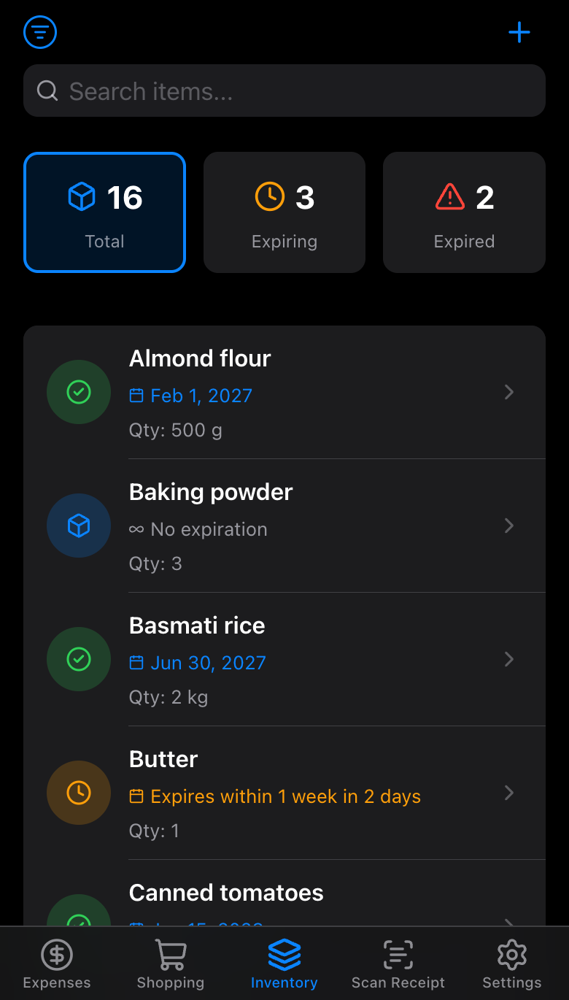

# Lifestyle OS — Web App


A personal household app for tracking monthly expenses by category and payment method, keeping a shopping list, and managing a home inventory with expiry dates. Photograph a supermarket receipt and AI translates to English and automatically add the items to your expense list in one go.

Next.js + Tailwind port of the iOS app in `../Lifestyle OS`, using the **same Supabase database**.
Built mobile-first (iOS look); on tablets/desktop the tab bar becomes a sidebar and sheets become centered dialogs.
On wide screens, Expenses becomes an iPadOS-style split view (see [Desktop](#desktop)).

## Screenshots

<p>
  
  
  
  
</p>

## Run

```bash
cp .env.example .env.local   # then fill in values (see below)
npm install
npm run dev                  # http://localhost:3000
```

| Variable | Purpose |
|---|---|
| `NEXT_PUBLIC_SUPABASE_URL` / `NEXT_PUBLIC_SUPABASE_ANON_KEY` | Same project + publishable key as `Config/SupabaseConfig.swift` |
| `GEMINI_API_KEY` | Server-only, for receipt scanning ([get one](https://aistudio.google.com/apikey)) |
| `GEMINI_MODEL` | Defaults to `gemini-3.5-flash-lite`, the iOS model |

## Desktop

From 1024px wide (laptop, or iPad in landscape), **Expenses** shows the list on the left and an overview or inspector pane on the right, with a single toolbar on top:

- **Nothing selected:** total with change vs last month, daily average, transaction count and a category breakdown. For the current month the comparison uses the same days of last month (e.g. Nov 1–22 vs Oct 1–22). Click a category to filter the list.
- **Expense selected:** its details, with Edit and Delete.
- **Right-click a row** (mouse or trackpad): Edit, show only that category, copy amount, delete.

Narrower windows keep the phone layout, and tapping a row opens the detail sheet.

### Keyboard shortcuts (Expenses)

| Key | Action |
|---|---|
| `/` or `⌘K` / `Ctrl+K` | Focus search |
| `↓` (in search) | Jump to the first result |
| `Esc` (in search) | Leave the search field |
| `N` | Add expense |
| `↑` `↓` or `K` `J` | Select previous / next expense |
| `Enter` or `E` | Edit the selected expense |
| `Backspace` / `Delete` | Delete the selected expense (asks first) |
| `Esc` | Clear the selection |

Selection shortcuts need the split view (1024px or wider). `/`, `⌘K` and `N` work at any width. Shortcuts are ignored while typing in a field or while a dialog is open. Adding uses `N` rather than `⌘N` because browsers reserve `⌘N` for a new window.

## Screens (iOS → web)

| iOS | Web |
|---|---|
| `LoginView` / `SignUpView` (merged: passwordless magic link) | `components/LoginView.tsx` |
| `ExpenseListView`, `AddExpenseView`, `EditExpenseView`, `ExpenseDetailView`, `MonthPickerView` | `app/expenses`, `components/expenses/*` |
| `ShoppingListsView`, `AddShoppingListView`, `EditShoppingListView` | `app/shopping`, `components/shopping/*` |
| `InventoryListView`, `AddInventoryItemView`, `InventoryDetailView` | `app/inventory`, `app/inventory/[id]` |
| `ReceiptScannerView` | `app/scan` + `app/api/scan-receipt` |
| `SettingsView` | `app/settings` |

## Notes

- Data access is client-side with supabase-js (like the Swift services), so Row Level Security does the work. As on iOS, `account_id` and `created_by_user_id` are the signed-in user's id.
- Dates are saved at local noon (`noonISO`), the same as `Calendar.noon(for:)` on iOS.
- Receipt scanning sends the photo (downscaled to 1600px) to `/api/scan-receipt`. The route checks the Supabase session, then calls Gemini with the iOS prompt. Gemini reads the image directly, so there is no separate OCR step.
- Swipe left on a row to delete it. With a mouse, hover over the row for a delete button.
